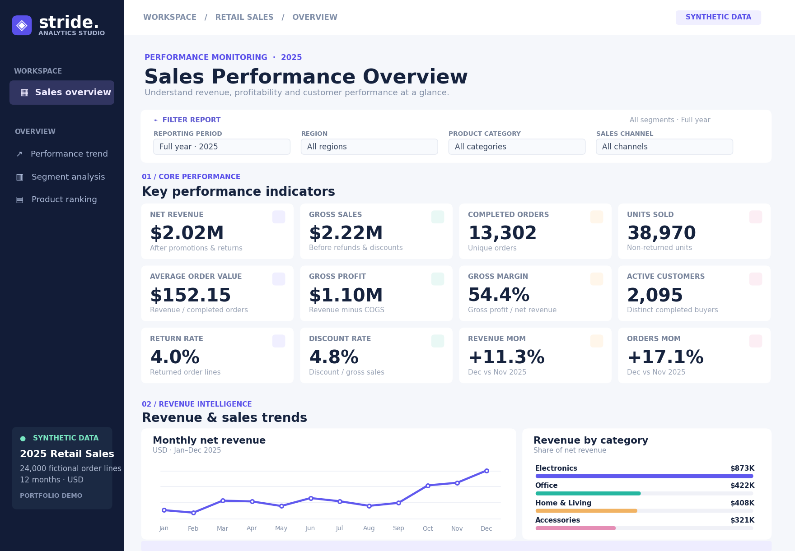

# Sales & KPI Performance Dashboard



*Illustrative visual summary generated from the same synthetic dataset; open `dashboard/index.html` for the actual interactive implementation.*

**A reproducible retail analytics portfolio project** | Python · SQLite (SQL) · Excel · JavaScript · Power BI-ready DAX

> **Data transparency:** All 24,000 order lines in this repository are **synthetic** and were generated with a fixed random seed. The products, customers, transactions and financial results are fictional and do not represent a real business.

## [Open the interactive dashboard](dashboard/index.html)

The browser-based dashboard is fully functional **offline**, requires **no server or npm**, and allows filtering by month, region, category and channel. Recomputed KPIs correctly deduplicate customers and orders, and the report includes monthly trends, product ranking and segment comparisons. Open `dashboard/index.html` in a browser. For GitHub Pages, publish the repo and link to `/dashboard/`.

## Project highlights

- **24,000** synthetic sales order lines spanning **12 months** in **2025**
- **12 documented KPIs**: revenue, orders, units, AOV, gross profit, margin, customers, return rate, discounts, and MoM growth
- Reproducible Python dataset creation with a fixed random seed; no private data
- SQLite schema, reusable SQL queries, 12 KPI exports, segment and trend reports
- Working responsive **HTML/JavaScript dashboard**, no third-party runtime dependencies
- Excel executive summary with linked formulas, monthly performance, segments and a chart
- DAX measures and instructions for building a *separate* Power BI report
- End-to-end Python `unittest` tests, optional Node.js dashboard smoke test, plus GitHub Actions CI

## Repository map

```text
sales-kpi-performance-dashboard/
├── README.md, GUIDE_FR.md, LICENSE
├── assets/dashboard_preview.png
├── dashboard/index.html, styles.css, app.js, sales_data.js
├── data/sales_transactions.csv
├── excel/Sales_KPI_Analysis.xlsx
├── analysis/sales_analysis.sqlite
│   └── exports/*.csv
├── sql/schema.sql, kpi_queries.sql, report_queries.sql
├── powerbi/MEASURES.dax, README.md
├── src/generate_data.py, run_analysis.py, build_dashboard_data.py
├── tests/test_pipeline.py
├── docs/DATA_DICTIONARY.md
└── .github/workflows/ci.yml
```

## Reproduce the entire analysis

Requires Python 3.10+ (standard library; no pip installation):

```bash
python -m src.generate_data
python -m src.run_analysis
python -m src.build_dashboard_data
python -m unittest discover -s tests -v
# Optional if Node.js is installed:
node tests/dashboard_smoke.cjs
```

The ready-to-use SQLite database is `analysis/sales_analysis.sqlite`. You can open it in DB Browser for SQLite or query it with Python.

Example SQL:

```sql
SELECT month, net_revenue, orders, gross_profit
FROM v_monthly_kpis
ORDER BY month;
```

## Results and presentation

See [`docs/CASE_STUDY.md`](docs/CASE_STUDY.md) for the 12 calculated KPIs, segment findings, interpretation, limitations, and a clear interview-ready portfolio description.

## Analytical design

**Grain:** a single order line (orders can span several lines). Returned lines have zero net revenue, zero COGS and zero gross profit. `Gross Sales` includes sales before promotions and refunds. `Completed Orders` counts distinct orders with at least one non-returned line. `Return Rate` counts returned **lines**, not returned orders. For precise definitions and assumptions, see [data dictionary](docs/DATA_DICTIONARY.md).

The same CSV feeds Python, SQL, the HTML dashboard, Excel aggregations and the optional Power BI import. Month-over-month growth compares the latest selected month with the preceding month while honoring non-date filters.

## Power BI note

`powerbi/MEASURES.dax` contains DAX and the setup guide is in [`powerbi/README.md`](powerbi/README.md). **A `.pbix` file is not included**; creating one requires Power BI Desktop. The shown dashboard screenshot is the functional HTML/JS implementation, **not a Power BI screenshot**. Do not imply otherwise when showcasing the project.

## Data provenance and ethics

All data are fictional, generated deterministically by [`src/generate_data.py`](src/generate_data.py) using a local PRNG. The project is a simulated analytical case study, **not real employer experience**, not scraped company data, and not a claim of business improvements. For a CV, label the work **“Portfolio project — synthetic retail data”**.

## License

MIT (code and documentation). Generated synthetic data included for demonstration.
